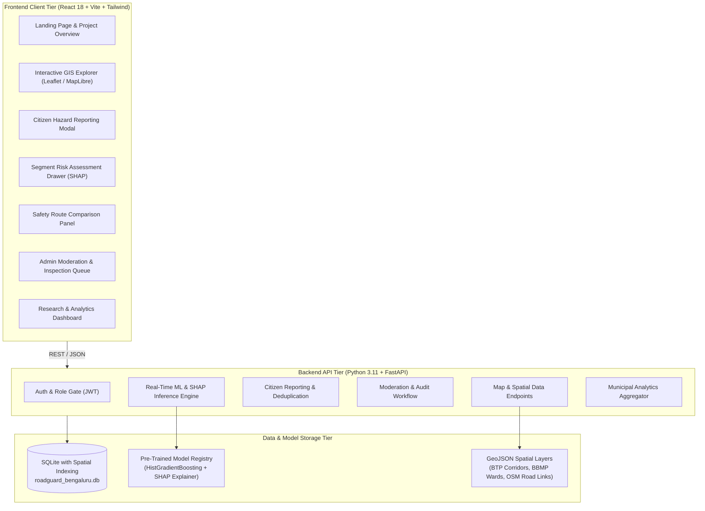
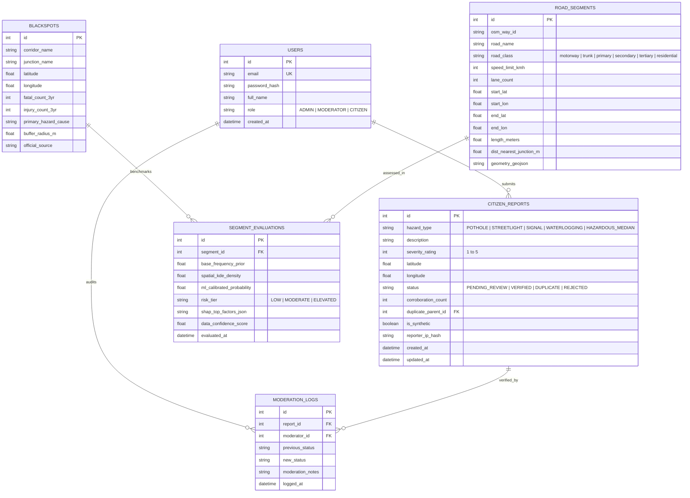

# ROADGUARD AI — PHASES FIVE, SIX & SEVEN: SYSTEM ARCHITECTURE, DATABASE SCHEMA & API SPECIFICATION
## UI/UX Design System, End-to-End Component Architecture, Database ER Model, and REST API Contracts

---

### 1. Executive Summary & Design System
**RoadGuard AI** is engineered as a high-performance, civic-tech and geospatial intelligence platform. It avoids garish neon colors and alarmist red banners, adopting a calm, data-dense, professional aesthetic inspired by modern municipal GIS portals and transportation command centers.

#### Design Tokens & Theme Philosophy
* **Brand Foundation:**
  * Primary Accent: Deep Slate Blue (`#1E293B` / `#0F172A`)
  * Data Visualization Accents:
    * Low Risk / Normal: Emerald Teal (`#10B981`)
    * Moderate Risk / Caution: Amber Ochre (`#F59E0B`)
    * High Risk / Chronic Blackspot: Crimson Ruby (`#EF4444`)
    * Citizen Hazard Layer: Electric Indigo (`#6366F1`)
  * Neutral Canvas: Slate Neutral (`#F8FAFC` in light mode, `#0B0F19` in dark/command-center mode)
* **Typography:** `Inter` / `system-ui` for maximum tabular legibility and GIS data density.
* **Component Standards:** Accessible contrast ratios ($\ge 4.5:1$), distinct keyboard focus rings, clear loading skeletons, and explanatory tooltips for every data metric.

---

### 2. End-to-End System Architecture



---

### 3. Database Entity-Relationship (ER) Schema

The database is built on **SQLite 3**, optimized with bounding-box spatial coordinates and indexed queries for lightning-fast sub-millisecond lookups on local environments.



---

### 4. REST API Specification (OpenAPI Contract)

All endpoints return uniform JSON payloads with standardized HTTP status codes and error bodies:
`{"status": "success", "data": {...}, "timestamp": "ISO-8601"}`.

#### 4.1 Public & Spatial Map APIs
* `GET /api/v1/health`
  * Returns system health, database status, loaded model version, and uptime.
* `GET /api/v1/map/layers`
  * Query parameters: `layer=all|blackspots|hazards|hotspots`, `severity_min=1`
  * Returns GeoJSON `FeatureCollection` containing:
    1. Documented BTP blackspot point markers and buffer polygons.
    2. Active citizen-reported hazard clusters with corroboration counts.
    3. Spatial KDE density contour points across the BBMP grid.
* `GET /api/v1/segments/{segment_id}`
  * Returns full **Segment Risk Assessment Card** payload:
    * Road geometry and metadata.
    * Official historical blackspot proximity and casualty statistics.
    * Calibrated ML risk probability ($\hat{p} \in [0, 1]$) with qualitative tier.
    * Local SHAP waterfall feature breakdown values.
    * Active citizen hazard count and Hazard Prioritization Index (HPI).
    * Recommended municipal remediation guidance.

#### 4.2 Citizen Reporting & Moderation APIs
* `POST /api/v1/reports`
  * Public endpoint for reporting an observed road hazard.
  * Request Body:
    ```json
    {
      "hazard_type": "POTHOLE",
      "description": "Large pothole cluster near bus bay causing sudden braking.",
      "severity_rating": 4,
      "latitude": 12.9352,
      "longitude": 77.6245
    }
    ```
  * Response: Returns created report ID, status (`PENDING_REVIEW` or `DUPLICATE_MERGED`), and updated corroboration count if an existing hazard is located within $50\text{m}$.
* `GET /api/v1/reports`
  * Query parameters: `status=PENDING_REVIEW|VERIFIED|ALL`, `hazard_type`, `limit=50`, `offset=0`.
* `PATCH /api/v1/admin/reports/{report_id}`
  * Protected endpoint (`Requires Role: MODERATOR or ADMIN`).
  * Request Body: `{"new_status": "VERIFIED", "moderation_notes": "Corroborated via ward inspection log."}`
  * Updates status, writes audit entry to `MODERATION_LOGS`, and refreshes the public map cache.

#### 4.3 Analytics & Research APIs
* `GET /api/v1/analytics/overview`
  * Returns city-wide summary aggregates:
    * Total historical blackspots (64).
    * Total citizen reports (subdivided by status: Pending, Verified, Resolved, Rejected).
    * Breakdown by hazard category (Potholes, Streetlights, Signals, Waterlogging).
    * Spatial distribution across Bengaluru zones (North, South, East, West, Central).
* `GET /api/v1/analytics/model-performance`
  * Returns formal empirical benchmark metrics table:
    * Comparison of $B_0$ Prior, $B_{\text{KDE}}$ Spatial Baseline, $B_{\text{LR}}$ Logistic Regression, $M_{\text{RF}}$ Random Forest, and $M_{\text{GBM}}$ Gradient Boosting.
    * Scores: PR-AUC, ROC-AUC, Brier Calibration Score, Precision, Recall, F1.
    * Global feature importances and dataset partitioning metadata.

#### 4.4 Route Risk Assessment API
* `POST /api/v1/routes/evaluate`
  * Evaluates two candidate routes between origin and destination coordinates in Bengaluru.
  * Request Body: `{"origin": [12.9716, 77.5946], "destination": [12.9279, 77.6271]}`
  * Computes route length, historical blackspot exposure count, cumulative segment risk score, and transparently compares relative safety profiles with uncertainty disclaimers.

#### 4.5 Authentication API
* `POST /api/v1/auth/login`
  * Authenticates administrators/researchers, issuing a signed JWT bearer token.
  * Pre-seeded credentials provided for university demonstration:
    * **Admin Role:** `admin@roadguard.ai` / `Admin@RoadGuard2026`
    * **Moderator Role:** `moderator@roadguard.ai` / `Moderator@RoadGuard2026`

---

### 5. Role & Permission Access Matrix

| Platform Action / Capability | Public Anonymous Citizen | Registered Citizen | Municipal Moderator | System Administrator |
| :--- | :---: | :---: | :---: | :---: |
| Explore Map & View Layers | Yes | Yes | Yes | Yes |
| Inspect Segment Risk Cards | Yes | Yes | Yes | Yes |
| Submit New Citizen Hazard Report | Yes | Yes | Yes | Yes |
| Evaluate Safety-Informed Routes | Yes | Yes | Yes | Yes |
| View Research & Analytics | Yes | Yes | Yes | Yes |
| Review Pending Citizen Reports | No | No | Yes | Yes |
| Approve / Reject / Merge Hazards | No | No | Yes | Yes |
| Manage User Roles & Audit Logs | No | No | No | Yes |
| Trigger Model Retraining Scripts | No | No | No | Yes |

---

### 6. Concrete Project Monorepo Structure

We establish a clean, production-grade monorepo at `/Users/rakshitkoul/.gemini/antigravity/scratch/roadguard-ai`:

```
roadguard-ai/
├── README.md                           # Comprehensive Setup, Run & Viva Guide
├── data/
│   ├── raw/                            # Original raw source files (BTP blackspots, OSM bbox)
│   ├── processed/                      # Cleaned SQLite DB (roadguard_bengaluru.db)
│   └── model_benchmark_metrics.json    # Verified empirical benchmark metrics
├── backend/
│   ├── main.py                         # FastAPI application entrypoint
│   ├── config.py                       # Configuration & environment variables
│   ├── database.py                     # SQLite engine & connection session
│   ├── models/                         # SQLAlchemy database models
│   │   ├── __init__.py
│   │   └── schemas.py
│   ├── api/                            # Modular API route controllers
│   │   ├── __init__.py
│   │   ├── map.py                      # Spatial GeoJSON & layers
│   │   ├── reports.py                  # Hazard reporting & deduplication
│   │   ├── segments.py                 # Segment details & SHAP cards
│   │   ├── routes.py                   # Route risk exposure calculation
│   │   ├── analytics.py                # Dashboard metrics & model benchmarks
│   │   └── auth.py                     # JWT authentication & moderation
│   ├── ml/                             # ML inference & pipeline modules
│   │   ├── __init__.py
│   │   ├── inference.py                # Fast in-memory model predictor & SHAP
│   │   ├── kde_engine.py               # Spatial Kernel Density Estimation
│   │   └── artifacts/                  # Serialized calibrated joblib models
│   └── tests/                          # Automated backend pytest suite
├── frontend/
│   ├── index.html                      # HTML5 shell
│   ├── package.json                    # React dependencies & scripts
│   ├── vite.config.ts                  # Vite build configuration
│   ├── tailwind.config.js              # Custom RoadGuard design tokens & colors
│   └── src/
│       ├── App.tsx                     # Main layout & navigation router
│       ├── main.tsx                    # React DOM entrypoint
│       ├── components/
│       │   ├── Navbar.tsx              # Top navigation & role switcher
│       │   ├── MapExplorer.tsx         # Leaflet GIS interactive map & layers
│       │   ├── ReportModal.tsx         # Citizen hazard reporting form
│       │   ├── SegmentDetailDrawer.tsx # SHAP waterfall & risk assessment card
│       │   ├── RouteComparison.tsx     # Route safety exposure evaluator
│       │   ├── AdminQueue.tsx          # Municipal moderation workflow
│       │   ├── AnalyticsView.tsx       # Empirical benchmarks & charts
│       │   ├── EmergencyDrawer.tsx     # Official emergency contacts & disclaimer
│       │   └── LandingSection.tsx      # Public introduction & methodology
│       └── services/
│           └── api.ts                  # Axios/Fetch API client
└── scripts/
    ├── ingest_bengaluru_data.py        # Seed BTP blackspots, OSM road links & synthetic reports
    ├── train_ml_pipeline.py            # Train B0, KDE, LR, RF, GBM & compute PR-AUC/SHAP
    └── run_all.sh                      # One-click startup script for viva demonstration
```

---

### 7. Sign-Off & Verification
With the complete design system, ER schema, OpenAPI endpoints, and monorepo structure approved, we proceed directly to **Phase Eight: Prototype Implementation**.
