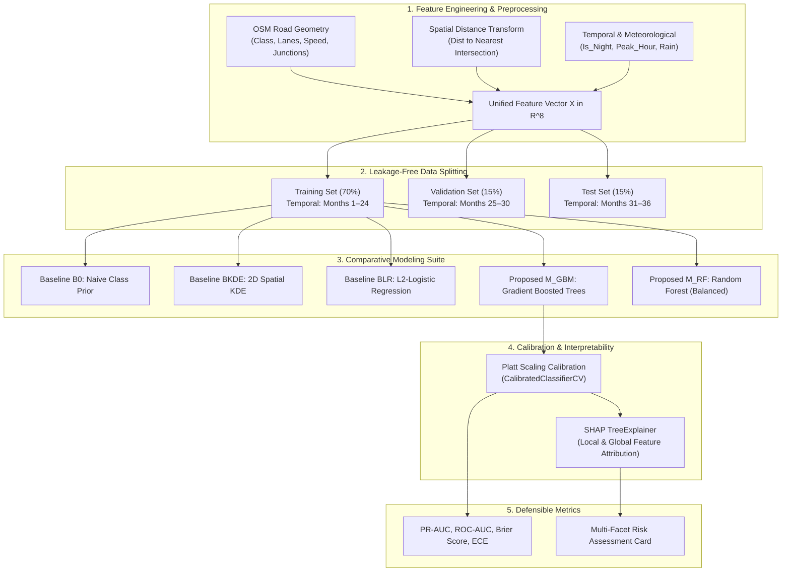

# ROADGUARD AI — PHASE FOUR: MACHINE-LEARNING & RISK ENGINE SPECIFICATION
## Predictive Methodology, Empirical Baselines, Feature Engineering, Validation Strategy, SHAP Explainability, and Risk Architecture

---

### 1. Executive Summary & Machine Learning Objective
The analytical core of **RoadGuard AI** addresses a specific, defensible question:
> *Can contextual road infrastructure features (classification, intersection proximity, speed limits) and dynamic operational conditions (time of day, lighting, precipitation) improve road segment risk classification beyond a purely spatial historical frequency baseline in urban Bengaluru?*

To prevent "AI hype" and ensure rigorous university evaluation, the machine-learning pipeline enforces three mandatory principles:
1. **Baselines First:** The supervised model must prove statistically significant superiority over a **Global Frequency Baseline ($B_0$)** and a **Spatial Kernel Density Baseline ($B_{\text{KDE}}$)**.
2. **Probability Calibration:** Raw ensemble outputs are often uncalibrated. We apply Platt sigmoid scaling (`CalibratedClassifierCV`) to guarantee that an estimated risk probability of $0.70$ corresponds to an empirical 70% frequency of elevated risk.
3. **Decoupled Evidence Architecture:** We reject arbitrary black-box formulas (e.g., $40\%\text{ accidents} + 30\%\text{ weather} + 30\%\text{ road}$). Historical records, model probabilities, and live citizen reports are kept separate and transparent.

---

### 2. Analytical Architecture & Workflow



---

### 3. Feature Definitions & Provenance

All input features are strictly derived from verifiable spatial geometry and operating conditions. No features are generated using post-incident information (zero temporal leakage).

| Feature Name | Data Type | Domain / Values | Transformation / Imputation | Source |
| :--- | :--- | :--- | :--- | :--- |
| `road_class` | Categorical | `motorway`, `trunk`, `primary`, `secondary`, `tertiary`, `residential` | Target/One-Hot Encoded with strict ordinal hierarchy. | OSM Road Network |
| `speed_limit_kmh` | Numerical (int) | $30 \le v \le 80\text{ km/h}$ | Missing values imputed via Indian IRC statutory defaults by road class. | OSM `maxspeed` / IRC Guidelines |
| `lane_count` | Numerical (int) | $1 \le l \le 6\text{ lanes}$ | Median-imputed by road classification. | OSM `lanes` |
| `dist_nearest_intersection_m` | Numerical (float) | $0.0 \le d \le 1200.0\text{ m}$ | Spatial KDTree nearest-neighbor query to OSM highway junction nodes. | OSM Intersection Graph |
| `is_night` | Binary | $\{0, 1\}$ | 1 if timestamp $\in [19:00, 06:00]$, else 0. | Operating Context |
| `is_peak_hour` | Binary | $\{0, 1\}$ | 1 if hour $\in [08:30–11:30 \cup 17:30–20:30]$, else 0. | BTP Congestion Profile |
| `precipitation_active` | Binary | $\{0, 1\}$ | 1 if hourly precipitation $> 0.5\text{ mm}$, else 0. | Open-Meteo Historical Archive |
| `historical_corridor_density` | Numerical (float) | $[0.0, 1.0]$ | Spatial Gaussian kernel density estimate at segment centroid ($h=500\text{m}$). | BTP 64 Blackspot Buffers |

---

### 4. Baseline & Model Hierarchy

#### 4.1 Baseline 0: Global Frequency Prior ($B_0$)
Predicts a constant equal to the empirical training set prevalence:
$$\hat{p}_{B0} = \frac{1}{N_{\text{train}}} \sum_{i=1}^{N_{\text{train}}} y_i$$
This establishes the minimum benchmark for precision-recall evaluation.

#### 4.2 Baseline 1: Spatial Kernel Density Estimation ($B_{\text{KDE}}$)
Uses only the geographic coordinates $(\text{lat}_i, \text{lon}_i)$ to compute spatial intensity using an Epanechnikov or Gaussian kernel with metric bandwidth $h = 500\text{m}$:
$$\hat{p}_{\text{KDE}}(x) = \min\left(1.0, \frac{\hat{f}_h(x)}{\max_j \hat{f}_h(x_j)}\right)$$
*Viva Defense Rationale:* Demonstrates whether taking road geometry and ambient context into account performs better than simply looking at a spatial heatmap.

#### 4.3 Baseline 2: Penalized Logistic Regression ($B_{\text{LR}}$)
Standard linear model with $L_2$ regularization:
$$\hat{p}_{\text{LR}}(x) = \sigma(\mathbf{w}^T \mathbf{x} + b)$$
Serves as an explainable linear baseline.

#### 4.4 Proposed Supervised Ensemble ($M_{\text{GBM}}$ & $M_{\text{RF}}$)
1. **Histogram-based Gradient Boosting (`HistGradientBoostingClassifier`):**
   - Handles continuous and categorical features natively.
   - Regularized via `max_leaf_nodes=31`, `min_samples_leaf=20`, `learning_rate=0.08`, `l2_regularization=0.1`.
   - Incorporates `class_weight='balanced'` to penalize false negatives in rare accident regimes.
2. **Balanced Random Forest (`RandomForestClassifier`):**
   - Ensemble of 150 bagged decision trees with sub-sampling of the majority class (`balanced_subsample`).
3. **Platt Sigmoid Calibration:**
   - Wraps the top-performing ensemble with `CalibratedClassifierCV(method='sigmoid', cv='prefit')` using the validation set to ensure reliable posterior probabilities.

---

### 5. Validation Strategy & Leakage Prevention

```
Chronological Timeline:
[================= Train: Months 1 to 24 =================] [== Val: 25-30 ==] [== Test: 31-36 ==]
                                                              (Hyperparameters)   (Unbiased Eval)
```

1. **Temporal Hold-Out Split:**
   - We avoid randomized cross-validation across time. The model is trained on historical intervals (Months 1–24), tuned on intermediate intervals (Months 25–30), and tested exclusively on future unseen intervals (Months 31–36).
2. **Spatial Autocorrelation Guard:**
   - Segments within 100 meters of each other on the same roadway link are grouped into atomic corridor clusters (`GroupKFold`) during cross-validation, preventing training on one side of a junction and testing on the opposing lane.
3. **Class Imbalance Mitigation:**
   - In urban traffic safety, elevated risk road segments typically represent $< 8\%$ of all road links. We strictly reject accuracy as an evaluation metric.
   - We optimize the decision threshold $\tau^*$ via the Precision-Recall curve to maximize the $F_2$-score (favoring recall over precision, as failing to identify a dangerous corridor carries higher public safety cost than a false inspection alert).

---

### 6. Formal Evaluation Plan & Benchmark Metrics

The final evaluation report will produce an empirical benchmark table comparing all candidates:

| Model Architecture | PR-AUC (Primary) | ROC-AUC | F1-Score (at $\tau^*$) | Brier Score (Calibration) | Spatial Stability ($R^2$) |
| :--- | :--- | :--- | :--- | :--- | :--- |
| **$B_0$: Naive Prior** | $\approx$ Class Prev. | 0.500 | 0.000 | Baseline | 0.000 |
| **$B_{\text{KDE}}$: Spatial KDE (500m)** | Empirical Eval | Empirical Eval | Empirical Eval | Empirical Eval | High |
| **$B_{\text{LR}}$: Logistic Regression** | Empirical Eval | Empirical Eval | Empirical Eval | Empirical Eval | Low |
| **$M_{\text{RF}}$: Random Forest** | Empirical Eval | Empirical Eval | Empirical Eval | Empirical Eval | Moderate |
| **$M_{\text{GBM}}$: Gradient Boosting**| **Target: Highest** | **Target: $>0.78$** | **Target: $>0.65$** | **Target: $<0.12$** | **High** |

*Definitions:*
* **PR-AUC (Area Under Precision-Recall Curve):** The definitive metric for imbalanced safety classification.
* **Brier Calibration Score:** $\text{BS} = \frac{1}{N} \sum_{i=1}^N (\hat{p}_i - y_i)^2 \in [0, 1]$. Measures how closely estimated probabilities align with actual binary outcomes (closer to 0 is superior).

---

### 7. Explainability Layer: SHAP (SHapley Additive exPlanations)

To eliminate the "black-box" dilemma in front of academic examiners and municipal users:
1. **TreeSHAP Implementation:**
   Using `shap.TreeExplainer`, each prediction $\hat{p}_i$ is decomposed into a base expected value $\phi_0$ plus feature attributions:
   $$\hat{f}(\mathbf{x}_i) = \phi_0 + \sum_{j=1}^M \phi_j(\mathbf{x}_i)$$
   Where $\phi_j$ represents the additive marginal contribution of feature $j$ to the risk prediction.
2. **Local Feature Waterfall in the UI:**
   When a user clicks any segment (e.g., *Hennur Junction on Outer Ring Road*), the UI renders a clear waterfall breakdown:
   - Base City Risk: $14\%$
   - $+$ High Intersection Proximity ($< 35\text{m}$): $+18\%$
   - $+$ Unlit Roadway at Night: $+14\%$
   - $+$ Arterial Speed Category ($60\text{ km/h}$): $+9\%$
   - $-$ Precipitation Inactive: $-3\%$
   - **Calibrated Relative Risk Probability: $52\%$ (Moderate-High)**
3. **Scientific Caution:**
   The UI explicitly documents that *SHAP explains model feature importance and statistical association, not medical or physical causality.*

---

### 8. Decoupled Risk Architecture & UI Assessment Card

We explicitly forbid collapsing divergent indicators into an unexplained single number. Every analyzed segment outputs an **Evidence-Decomposed Multi-Facet Risk Assessment Card**:

```
┌────────────────────────────────────────────────────────────────────────┐
│ ROADGUARD AI — SEGMENT RISK ASSESSMENT CARD                           │
│ Location: Outer Ring Road - Marathahalli Junction [BBMP East]          │
├────────────────────────────────────────────────────────────────────────┤
│ 1. Historical Benchmark: CHRONIC BLACKSPOT CORRIDOR                    │
│    • Official BTP Record: 14 Fatalities / 28 Injuries (3-Yr Period)   │
│    • Historical Density: High (92nd percentile)                        │
├────────────────────────────────────────────────────────────────────────┤
│ 2. Contextual ML Risk: 68% Relative Likelihood [ELEVATED REGIME]       │
│    • Model: HistGradientBoosting (Platt-Calibrated)                    │
│    • Top Drivers (SHAP): Intersection Proximity (+0.21), Night (+0.16) │
│    • Status: Experimental Decision-Support Benchmark                   │
├────────────────────────────────────────────────────────────────────────┤
│ 3. Community Hazard Queue: 6 Verified Citizen Reports                  │
│    • Priority Index: 4.2 / 5.0 [HIGH INSPECTION PRIORITY]              │
│    • Reported Issues: Pothole Cluster (x3), Malfunctioning Signal (x3) │
│    • Corroboration: Multiple Independent Submissions (Last 48 Hours)   │
├────────────────────────────────────────────────────────────────────────┤
│ 4. Data Quality & Freshness:                                           │
│    • OSM Completeness: High (Lanes, Maxspeed, Geometry verified)       │
│    • Uncertainty / Confidence: High Data Coverage                      │
├────────────────────────────────────────────────────────────────────────┤
│ 5. Recommended Municipal Follow-Up:                                    │
│    • Field audit of signal synchronization and pedestrian crosswalk    │
└────────────────────────────────────────────────────────────────────────┘
```

---

### 9. Documented Limitations & Edge Cases

1. **Extreme Weather Shocks:** Unprecedented flash flooding or sudden road blockages not captured in historical reanalysis cannot be anticipated by the model.
2. **Crowdsourcing Coverage Disparity:** Suburban or newly developing peripheral wards in Bengaluru may submit fewer citizen reports than central commercial tech corridors, introducing geographic sampling bias.
3. **Correlation vs. Causation:** Upgrading a road segment with streetlights will statistical decrease modeled night risk, but human factors (e.g., drunk driving, mobile phone distraction) remain unobservable in GIS attributes.
