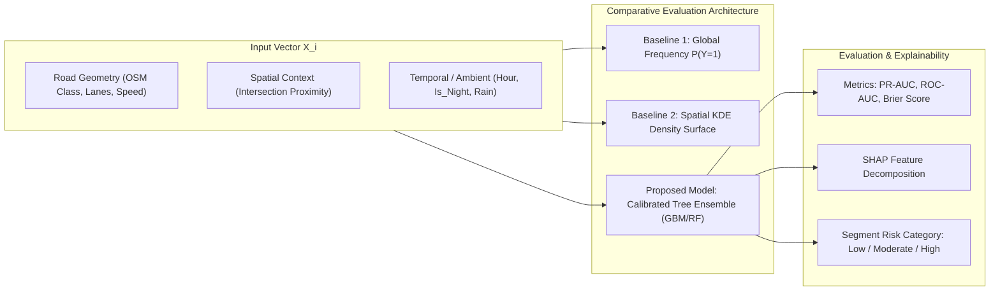

# ROADGUARD AI — PHASE THREE: FORMAL RESEARCH PROBLEM DEFINITION
## Task Formulation, Unit of Analysis, Comparative Evaluation, and Mathematical Specifications

---

### 1. Executive Summary & Core Research Decision
In academic research, the vague phrase *"AI accident prediction"* is scientifically invalid. Accidents are rare, stochastic spatial-temporal events influenced by non-deterministic human behavior, mechanical failure, and momentary distraction. A computer science system cannot claim to predict that *"a crash will happen at Silk Board at 5:14 PM."*

Instead, **RoadGuard AI** formulates a scientifically rigorous, defensible, and empirically verifiable primary research task:

> **Primary Research Problem (Contextual Road Segment Relative Risk Classification):**  
> Formulated as an explainable supervised classification problem: Given a spatial road segment $s$ in urban Bengaluru characterized by static geometric attributes (road classification, intersection density, lane count, speed category) and temporal/environmental operating context (time of day, lighting condition, precipitation), estimate the **relative likelihood** that the segment belongs to an elevated crash risk regime (exhibiting historical blackspot corridor severity), evaluated against an empirical **Spatial Frequency Baseline** and an **Empirical KDE Baseline**.

This primary research problem is directly reinforced by three complementary decision-support capabilities:
1. **Supporting Capability 1 (Spatial Analytics):** Empirical Kernel Density Estimation (KDE) and grid-based historical hotspot identification across Bengaluru.
2. **Supporting Capability 2 (Civic Decision-Support):** Multi-factor Hazard Prioritization Index (HPI) for municipal inspection queues.
3. **Supporting Capability 3 (Commuter Utility):** Safety-Informed Route Risk Exposure Assessment.

---

### 2. Comparative Evaluation of Candidate Formulations

| Evaluation Criterion | Option A: Historical Hotspot Detection Alone | Option B: Hazard Prioritization Alone | Option C: Contextual Segment Risk Modeling (SELECTED PRIMARY) | Option D: Route Safety Comparison Alone |
| :--- | :--- | :--- | :--- | :--- |
| **Data Availability** | High (BTP blackspots & crash points) | High (Crowdsourced + synthetic records) | High (OSM network + BTP blackspots + weather) | Moderate (Requires routing graph + risk weights) |
| **Research Value** | Moderate (Standard GIS technique) | Moderate (Civic-tech prioritization heuristic) | **High** (Comparative ML vs. spatial baselines, class imbalance, SHAP) | Moderate (Applied heuristic) |
| **Implementation Difficulty** | Low–Moderate | Low | Moderate | Moderate–High |
| **Validation Feasibility** | High (Spatial cluster stability across bandwidths) | Moderate (Rank stability, inspection throughput) | **Very High** (Strict temporal hold-out split, PR-AUC, ROC-AUC, Brier score) | Low (No ground truth for whether a route was "safe") |
| **Academic Defensibility** | Strong, but lacks ML novelty | Strong for civic-tech; weak for CS viva | **Highest** (Scientifically grounded, transparent baselines, no false claims) | Low if claimed as predictive |
| **Viva Defense Strength** | Moderate ("Why is this not just QGIS?") | Moderate ("Where is the machine learning?") | **High** ("We evaluated whether contextual features beat spatial baselines.") | Moderate if presented as an exposure metric |
| **Completion Risk (~1 week)**| Very Low | Very Low | **Optimal** (Scikit-learn pipeline, fast training, verified metrics) | Moderate |

---

### 3. Formal Mathematical & Technical Specification

#### 3.1 Primary Task: Supervised Relative Risk Classification
* **Unit of Analysis ($s_i$):** An OpenStreetMap road segment or 250m buffered corridor centroid in the BBMP area.
* **Feature Vector ($\mathbf{x}_i \in \mathbb{R}^d$):**
  1. `road_class_encoded`: Categorical (Motorway=0, Trunk=1, Primary=2, Secondary=3, Tertiary=4, Residential=5).
  2. `speed_limit_kmh`: Integer (30 to 80 km/h).
  3. `lane_count`: Integer (1 to 6 lanes).
  4. `intersection_proximity_m`: Continuous Euclidean distance to nearest road junction node ($0\text{m}$ to $1000\text{m}$).
  5. `is_night`: Binary indicator (1 if time $\in [19:00, 06:00]$, else 0).
  6. `is_peak_hour`: Binary indicator (1 if time $\in [08:30–11:30, 17:30–20:30]$, else 0).
  7. `precipitation_active`: Binary indicator (1 if rain $> 0.5\text{mm}$, else 0).
  8. `historical_blackspot_proximity_m`: Distance to nearest chronic BTP blackspot corridor.
* **Target Variable ($y_i \in \{0, 1\}$):**
  * $y_i = 1$: Segment exhibits elevated high-severity crash risk (intersects with documented BTP blackspot buffer).
  * $y_i = 0$: Segment operates under standard baseline urban safety conditions.
* **Target Metric:** Calibrated posterior probability $\hat{p}_i = \hat{P}(y_i = 1 \mid \mathbf{x}_i) \in [0, 1]$.
* **Prediction Horizon:** Static structural risk modulated by hourly operating conditions.

#### 3.2 Formal Baselines for Academic Comparison
1. **Naive Spatial Frequency Baseline ($B_0$):**
   Predicts the prior historical probability of risk uniformly across all segments:
   $$\hat{p}_{\text{base}} = \frac{1}{N} \sum_{j=1}^N y_j$$
2. **Empirical Spatial Kernel Density Baseline ($B_{\text{KDE}}$):**
   Estimates relative risk solely based on spatial coordinates $(\text{lat}_i, \text{lon}_i)$ using a Gaussian kernel:
   $$\hat{f}_h(x) = \frac{1}{n h^2 2\pi} \sum_{j=1}^n \exp\left(-\frac{d(x, x_j)^2}{2h^2}\right)$$
   where $h$ is the bandwidth ($500\text{m}$).
3. **Proposed Supervised Ensemble ($M_{\text{GBM}}$):**
   Gradient Boosted Decision Trees trained on $\mathbf{x}_i$, tuned using 5-fold cross-validation on the training set, evaluated against $B_0$ and $B_{\text{KDE}}$ on the hold-out test set.

#### 3.3 Supporting Task 1: Historical Hotspot Clustering
* **Method:** Planar Kernel Density Estimation compared with uniform hexagonal grid cell aggregation ($500\text{m} \times 500\text{m}$).
* **Purpose:** Provides the empirical historical layer on the map, allowing users to inspect recorded blackspot clusters independently of model predictions.

#### 3.4 Supporting Task 2: Citizen Hazard Prioritization Index (HPI)
For municipal inspection teams, unmoderated citizen reports cannot be checked all at once. We specify a transparent, documented **Hazard Prioritization Index**:
$$\text{HPI}(r) = \left( w_{\text{sev}} \cdot S_r + w_{\text{corr}} \cdot \min(C_r, 5) + w_{\text{rec}} \cdot e^{-\lambda \Delta t} \right) \cdot V_r$$
Where:
* $S_r \in [1, 5]$: Severity score based on hazard type (Pothole=3, Missing Streetlight=2, Waterlogging=3, Broken Traffic Signal=4, Major Structural Road Cave-in=5).
* $C_r \in [1, \infty)$: Number of deduplicated corroborating citizen reports.
* $\Delta t$: Age of the report in days; $\lambda = 0.05$ (decay factor preserving urgency).
* $V_r \in \{0.5, 1.0, 1.2\}$: Verification multiplier (Unverified=0.5, Community-Corroborated=1.0, Official-Audited=1.2).
* Weights: $w_{\text{sev}} = 0.4$, $w_{\text{corr}} = 0.35$, $w_{\text{rec}} = 0.25$.
* *Academic note:* This is explicitly labeled in the UI as a **documented multi-criteria heuristic**, not an unexplained ML black box.

#### 3.5 Supporting Task 3: Safety-Informed Route Risk Exposure
For candidate routes $R_A$ and $R_B$ between origin and destination:
$$\text{Exposure}(R) = \sum_{k \in R} \text{Length}(s_k) \times \hat{p}(s_k)$$
The system visualizes relative exposure without claiming any route is "accident-free."

---

### 4. Explicit Boundary Definitions & Disclaimers

| What RoadGuard AI Does | What RoadGuard AI Does NOT Do |
| :--- | :--- |
| Estimates relative risk probabilities based on historical patterns and road features. | Does **not** predict that an individual driver will crash at an exact timestamp. |
| Highlights chronic historical blackspot corridors identified by traffic authorities. | Does **not** claim to replace official police accident investigation teams. |
| Ranks reported citizen hazards to optimize municipal maintenance scheduling. | Does **not** send emergency dispatches (112 / ambulance) automatically. |
| Explains model outputs using SHAP feature contributions. | Does **not** make causal assertions (correlation $\neq$ causation). |
| Compares candidate routes by safety exposure. | Does **not** guarantee that a lower-scoring route is safe from unforeseen hazards. |

---

### 5. Research Definition Sign-Off
By focusing our primary research on **Contextual Segment Risk Classification vs. Spatial Baselines**, supported by **Empirical Hotspots** and **Hazard Prioritization**, the project achieves:
1. **Bulletproof academic defensibility in viva:** Any examiner asking *"How is this different from a heatmap?"* will be answered with empirical PR-AUC comparisons against KDE baselines.
2. **Feasible execution within 1 week:** Models train in seconds on Scikit-learn, with lightweight persistence and sub-millisecond REST inference.
