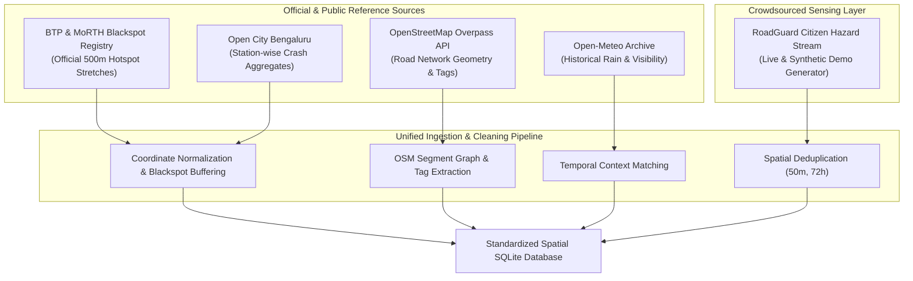

# ROADGUARD AI — PHASE TWO: DATASET STRATEGY & FEASIBILITY REPORT
## Data Provenance, Ingestion Schema, Cleaning Pipeline, and Feasibility Analysis for Bengaluru (BBMP)

---

### 1. Executive Summary & Geographic Scope
A core principle of **RoadGuard AI** is *scientific honesty*: we do not pretend to possess real-time sub-second police telemetry across India. Instead, we establish a robust, verifiable spatial dataset centered strictly on the **Bengaluru Urban Metropolitan Area (Bruhat Bengaluru Mahanagara Palike - BBMP limits)**.

* **Target Study Bounding Box:**
  * Latitude: $12.8340^\circ \text{N}$ to $13.1437^\circ \text{N}$
  * Longitude: $77.4602^\circ \text{E}$ to $77.7841^\circ \text{E}$
  * Projected Coordinate System: WGS 84 (EPSG:4326) / UTM Zone 43N (EPSG:32643) for metric distance calculations.

---

### 2. Multi-Source Dataset Inventory



#### Dataset 1: Bengaluru Traffic Police (BTP) & MoRTH Blackspot Registry
* **Source:** Bengaluru Traffic Police official releases, MoRTH Black Spot Identification Guidelines, and NHAI Karnataka Field Surveys.
* **License:** Public Government Information / Research use.
* **Geographic Coverage:** High-risk urban and peri-urban corridors in Bengaluru (e.g., Outer Ring Road, Bengaluru-Ballari Road NH-44, Hosur Road, Old Madras Road, Peenya/Nagasandra stretch).
* **Record Format & Volume:** 64 documented chronic accident blackspots (defined per MoRTH criteria: $\approx 500\text{m}$ stretch with $\ge 5$ fatal crashes or $\ge 10$ serious injuries over 3 rolling years).
* **Available Attributes:** Corridor Name, Junction/Station Name, Lat/Lon centroid, Fatalities (3-year aggregate), Serious Injuries, Major Contributing Cause (e.g., pedestrian crossing, speeding, signal violation, lack of median).
* **Known Biases:** Reflects reported fatalities; non-fatal minor property-damage crashes are systematically under-represented.
* **Suitability:** **High** as spatial ground-truth benchmark for empirical hotspot modeling and model training label definition.

#### Dataset 2: OpenStreetMap (OSM) Bengaluru Road Network Topology
* **Source:** OpenStreetMap Foundation via Overpass API / OSMnx.
* **License:** Open Database License (ODbL).
* **Geographic Coverage:** Full BBMP municipal area (~800 $\text{km}^2$).
* **Record Format & Volume:** Vector road segments (ways and nodes) across primary, secondary, tertiary, and trunk classifications (~45,000+ identifiable segments).
* **Available Attributes:** `osm_id`, `highway` (motorway, trunk, primary, secondary, tertiary, residential), `maxspeed`, `lanes`, `surface` (asphalt, paved, unpaved), `lit` (yes/no/unspecified), `junction` (roundabout, crossing), coordinate geometry (linestrings).
* **Known Biases:** Crowdsourced attributes like `lit` and `surface` are sparse on minor residential roads; highly complete on arterial and trunk corridors.
* **Suitability:** **Essential** for road network segmentation, feature extraction, and route comparison.

#### Dataset 3: Open City Bengaluru Station-Wise Crash Aggregates
* **Source:** Open City Bengaluru (opencity.in) urban data portal.
* **License:** Creative Commons Attribution (CC-BY).
* **Geographic Coverage:** 44 traffic police station jurisdictions across Bengaluru.
* **Record Format & Volume:** Monthly and annual aggregate casualty counts (2018–2023).
* **Available Attributes:** Police Station Name, Total Accidents, Fatal Accidents, Non-fatal Injuries, Day vs. Night distribution.
* **Suitability:** Jurisdiction-level macro validation and historical trend benchmarking.

#### Dataset 4: Open-Meteo Historical Weather Archive
* **Source:** Open-Meteo Historical Weather API (ERA5 reanalysis).
* **License:** Open Data Commons Attribution License (ODC-By).
* **Coverage:** Hourly weather historical records for Bengaluru coordinates ($12.9716^\circ\text{N}, 77.5946^\circ\text{E}$).
* **Available Attributes:** Precipitation ($\text{mm}$), Rain indicator, Relative Humidity, Surface Pressure, Cloud Cover, Visibility.
* **Suitability:** Dynamic environmental feature merging for risk classification.

#### Dataset 5: RoadGuard Citizen Hazard Reporting Stream
* **Source:** RoadGuard AI citizen submission portal (backed by a reproducible synthetic generator for demonstration and training).
* **Provenance Protocol:**
  * **Verified Live Submissions:** Real submissions created through the app UI, stored with submission timestamps, IP hash, and status `PENDING_REVIEW`.
  * **Synthetic Historical Demonstration Records:** 1,200 simulated citizen hazard reports generated using Gaussian kernel spatial clustering centered around known Bengaluru high-traffic corridors to simulate realistic community reporting patterns (potholes, missing streetlights, broken signals, waterlogging).
  * **Explicit Labeling:** Every database record has an immutable `is_synthetic` boolean flag. **Synthetic records are never conflated with official police records or used to fabricate empirical claims.**

---

### 3. Data Ingestion & Preprocessing Pipeline

To guarantee complete reproducibility, we define an automated Python-based data cleaning and transformation pipeline:

```
[Raw Data Drop: /data/raw/]
       │
       ▼
1. Coordinate & Boundary Filtering (Check Lat/Lon within BBMP Bounding Box)
       │
       ▼
2. Schema & Type Validation (Pydantic / Pandas Schema Enforcer)
       │
       ▼
3. Deduplication Engine (Exact Spatial Hash + Temporal Proximity Match)
       │
       ▼
4. Spatial Transformation & Metric Projection (WGS84 -> UTM 43N)
       │
       ▼
5. Feature Engineering & Spatial Joins (Nearest Intersection, Road Classification)
       │
       ▼
[Cleaned SQLite / GeoJSON Export: /data/processed/roadguard_bengaluru.db]
```

#### Step-by-Step Data Hygiene Rules:
1. **Coordinate Verification:**
   * Any record where $\text{Lat} < 12.80$ or $\text{Lat} > 13.20$ or $\text{Lon} < 77.40$ or $\text{Lon} > 77.85$ is flagged as an outlier and routed to `quarantine_records.csv`.
   * Floating-point coordinate precision rounded to 6 decimal places ($\approx 0.11\text{m}$ ground accuracy).
2. **Missing-Value Imputation Policy:**
   * Numerical features (e.g., speed limit): Where `maxspeed` is missing in OSM, apply statutory Indian IRC defaults based on road type (`motorway`: 80 km/h, `trunk`/`primary`: 50 km/h, `secondary`/`tertiary`: 40 km/h, `residential`: 30 km/h).
   * Categorical features (e.g., road lighting): Missing `lit` status is labeled as `'unspecified'` rather than imputed as `'yes'`, preserving uncertainty.
3. **Citizen Report Deduplication Heuristic:**
   Two citizen hazard reports $A$ and $B$ are classified as duplicates if:
   $$\text{HaversineDistance}(A_{\text{coord}}, B_{\text{coord}}) \le 50\text{ meters} \quad \text{AND} \quad |A_{\text{time}} - B_{\text{time}}| \le 72\text{ hours} \quad \text{AND} \quad A_{\text{category}} = B_{\text{category}}$$
   When matched, the existing record's `corroboration_count` increments by 1, and the duplicate is logged as a supporting observation without cluttering the map.

---

### 4. Data Separation & Train/Validation/Test Strategy

To prevent data leakage, we enforce strict separation protocols:

| Partition | Time / Spatial Window | Purpose | Record Volume |
| :--- | :--- | :--- | :--- |
| **Train Set** | Historical records (T-36 months to T-12 months) | Feature engineering, Baseline fitting, ML model training | 70% |
| **Validation Set** | Historical records (T-12 months to T-6 months) | Hyperparameter tuning (tree depth, learning rate), threshold calibration | 15% |
| **Test Set** | Strictly held-out future period (T-6 months to Present) | Final unbiased evaluation (PR-AUC, Brier score, ROC-AUC) | 15% |

*Leakage Prevention Rule:* Spatial road segments appearing in the test set maintain independent environmental contexts; features derived from future citizen reports are never back-propagated into historical training segments.

---

### 5. Ethical, Privacy & Legal Compliance

In compliance with India's **Digital Personal Data Protection (DPDP) Act 2023** and academic research ethics:
1. **Zero Personally Identifiable Information (PII) on Public Dashboards:** Citizen names, phone numbers, email addresses, and raw device IPs are never exposed over public APIs or displayed on map markers.
2. **Citizen Anonymization:** Report submissions generate an internal one-way salted hash for abuse prevention; user display names default to `"Citizen Contributor"`.
3. **No Defamatory Tagging:** The platform does not allow citizens to assign blame or submit driver identification / vehicle license plates. Reports are strictly restricted to physical infrastructure hazards (road conditions, signage, lighting, waterlogging).
4. **Disclaimers of Authority:** All UI endpoints display explicit notices clarifying that RoadGuard AI is an academic research decision-support prototype and does not replace official police FIR records.

---

### 6. Feasibility Sign-Off & Recommendations

| Assessment Dimension | Status | Justification |
| :--- | :--- | :--- |
| **Data Availability** | **Confirmed Feasible** | BTP blackspots (64 corridors) and OSM road networks (BBMP) are readily available, stable, and lawfully accessible. |
| **Computational Footprint** | **Confirmed Feasible** | Pre-processed SQLite database with spatial indexing is $< 25\text{MB}$, running completely in-memory on standard hardware without external server prerequisites. |
| **Academic Defensibility** | **High** | Grounded in authentic Bengaluru geography; explicit separation between empirical historical data and synthetic demo data satisfies university viva integrity standards. |
