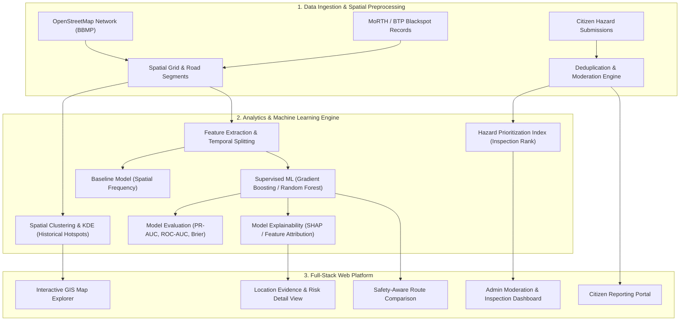
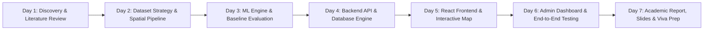

# ROADGUARD AI — PROJECT CHARTER
## Final-Year University Project & Research Specification (Phase Zero)

---

### 1. Project Title
**RoadGuard AI: Smart Road Accident Prevention & Decision-Support Platform Using Geospatial Analytics, Machine Learning, and Community Reporting**  
*(Focus Study: Bengaluru Urban / BBMP Metropolitan Corridor)*

---

### 2. Abstract
Road traffic accidents in India result in over 150,000 fatalities annually, representing a critical public health and urban planning challenge. Traditional traffic safety management relies predominantly on delayed, fragmented post-incident police reports, lacking real-time spatial integration with crowdsourced road hazard indicators and predictive risk modeling. **RoadGuard AI** is an academic research prototype and geospatial decision-support platform designed to bridge this divide. Focusing on the urban transit corridors of Bengaluru (BBMP), the platform integrates OpenStreetMap (OSM) spatial geometry, officially documented accident blackspots (Bengaluru Traffic Police / MoRTH), and verified citizen hazard reports. 

The analytical engine introduces a multi-tier spatial assessment architecture: Kernel Density Estimation (KDE) and spatial grid clustering for empirical historical hotspot detection, a multi-factor hazard inspection prioritization index, and an explainable machine learning classifier (Gradient Boosting / Random Forest) trained on temporal, structural, and environmental road features to estimate localized relative risk. Crucially, the platform separates empirical history from probabilistic prediction, offering transparent evidence decomposition, SHAP-driven model explanations, an administrative moderation workflow, and an interactive GIS dashboard. This charter outlines the academic scope, constraints, and accelerated delivery roadmap for university viva examination.

---

### 3. Problem Statement
1. **Siloed and Retrospective Data:** Road accident documentation in Indian urban centers is largely retrospective and static, preventing proactive municipal intervention before accidents recur at known structural hazard sites.
2. **Lack of Community Ground-Truth:** Municipal authorities often discover potholes, waterlogging, malfunctioning streetlights, and missing road signage only after fatal incidents occur, as there is no structured, moderated pipeline to convert citizen reports into actionable geospatial evidence.
3. **The "Black-Box" AI Dilemma:** Many academic safety systems generate unvalidated, arbitrary "risk scores" without baseline comparisons, spatial cross-validation, or clear explanations of uncertainty, rendering them indefensible in scientific review and unusable for municipal decision-makers.

---

### 4. Motivation
India accounts for approximately 11% of global road crash fatalities despite having only 1% of the world's vehicles (World Bank, 2020). In rapidly expanding metropolitan hubs like Bengaluru, the rapid growth of vehicular density combined with infrastructure bottlenecks creates chronic accident corridors (e.g., Outer Ring Road, Hosur Road, Old Madras Road). A transparent, evidence-based decision-support system that synthesizes historical accident records with live community observations can empower both commuters and municipal road-safety engineers to prioritize hazardous segments for physical remediation.

---

### 5. Aim & Objectives
#### Primary Aim:
To design, implement, evaluate, and demonstrate an end-to-end, reproducible, and explainable geospatial web platform that integrates historical accident records, crowdsourced hazard reporting, and machine learning to analyze and visualize road safety risks across urban Bengaluru.

#### Specific Objectives:
1. **Data Engineering & Geospatial Layering:** Curate, clean, and spatialize road network data for Bengaluru using OpenStreetMap and documented blackspot corridors, establishing a standardized GeoJSON/SQLite spatial database.
2. **Spatial Analytics & Hotspot Detection:** Implement and compare spatial clustering algorithms (Kernel Density Estimation and Grid Aggregation) to map historical accident concentrations without conflating historical density with future certainty.
3. **Citizen Reporting & Moderation Pipeline:** Develop an authenticated, privacy-preserving reporting portal enabling citizens to submit geolocated road hazards (potholes, poor lighting, traffic bottlenecks) with duplicate-detection heuristics and an administrative review workflow.
4. **Machine Learning Risk Engine:** Train, calibrate, and validate a supervised classification model on road segment features (road type, speed class, lighting, weather conditions, time of day, proximity to intersections) against rigorous baselines (spatial frequency baseline), evaluated using PR-AUC, ROC-AUC, and Brier calibration score.
5. **Explainability & Decision Support:** Provide feature-attribution explanations (SHAP / Tree Feature Importance) for model inferences, ensuring every risk rating clearly displays the underlying evidence, data freshness, and uncertainty level.
6. **Full-Stack GIS Prototype:** Deliver a modern, accessible web application (React + Vite + Tailwind CSS + Leaflet/MapLibre + FastAPI) featuring an interactive safety map, analytics dashboard, location detail breakdown, route risk comparison, and emergency guidance panel.
7. **Academic Defense & Documentation:** Produce a university-grade technical dissertation, presentation slide deck, rehearsed demonstration script, and viva defense guide.

---

### 6. Research Questions
* **RQ1:** To what extent does spatial Kernel Density Estimation (KDE) provide a stable and defensible identification of chronic accident corridors compared to simple spatial grid frequency counts in urban Bengaluru?
* **RQ2:** Can road network contextual features (classification, intersection proximity, surface attributes, temporal factors) improve accident risk classification beyond a purely spatial historical frequency baseline?
* **RQ3:** How can crowdsourced citizen hazard reports be systematically moderated, de-duplicated, and integrated into a quantitative hazard prioritization index for municipal inspection teams?
* **RQ4:** How does presenting model explanations (feature contributions and uncertainty indicators) impact the interpretability and decision utility of road safety dashboards for non-technical evaluators?

---

### 7. Proposed Methodology

---

### 8. Expected Outcomes
1. **Working Full-Stack Software Prototype:** Fully interactive web application accessible on local host and portable via standard scripts.
2. **Reproducible Machine Learning Pipeline:** Tested data cleaning, feature engineering, baseline vs. ML evaluation scripts with documented metrics.
3. **Documented Bengaluru Safety Dataset:** Validated GeoJSON and tabular dataset containing verified blackspot records, road segment attributes, and synthetic citizen hazard demonstrations.
4. **Complete Academic Deliverables:** Publication-ready dissertation chapters, slide deck, demo video script, and comprehensive viva preparation manual.

---

### 9. Scope & Out-of-Scope

| In-Scope | Out-of-Scope (Explicitly Disclaimed) |
| :--- | :--- |
| Focus on Bengaluru Urban (BBMP) municipal limits | Pan-India real-time satellite imagery feeds |
| Spatial hotspot clustering (KDE & DBSCAN/Grid) | Claiming real-time automated accident prevention |
| Supervised relative risk modeling on road segments | Live direct dispatch integration with 112/police |
| Citizen reporting with validation and duplicate checks | Hardware in-vehicle telemetry / OBD-II sensors |
| Role-based administrative verification dashboard | Live closed-circuit TV (CCTV) automated video streaming |
| Explainable risk breakdown with confidence metrics | Unexplained black-box 0-100 scores without evidence |
| Safety-informed candidate route comparison | Claiming any route is objectively "guaranteed safe" |

---

### 10. Constraints & Assumptions
* **Time Constraint:** ~1 week (7 calendar days) until final submission. Architecture must be modular, reliable, zero-bloat, and immediately runnable.
* **Technology Stack:**
  * **Frontend:** React 18, TypeScript, Vite, Tailwind CSS, Lucide Icons, Leaflet / React-Leaflet.
  * **Backend:** Python 3.11+, FastAPI, Uvicorn, SQLite (with spatial indexing via Haversine and bounding-box queries), Pydantic v2.
  * **Data Science / ML:** Pandas, NumPy, Scikit-learn, Shap/Joblib, GeoPandas / Shapely.
* **Data Assumption:** Given the absence of public real-time sub-second police telemetry for Bengaluru, the project utilizes verified public MoRTH/BTP blackspot corridor coordinates and OpenStreetMap infrastructure, complemented by a rigorously documented, separate synthetic data generator for citizen reporting simulations.

---

### 11. Risk Register

| Risk ID | Risk Description | Severity | Likelihood | Mitigation Strategy |
| :--- | :--- | :--- | :--- | :--- |
| **R-01** | High class imbalance in accident occurrence data | High | High | Use stratified temporal splitting, PR-AUC, Brier score, and class-weighting rather than raw accuracy. |
| **R-02** | Viva examiner asks if AI "prevents" accidents | High | Medium | Emphasize throughout the UI and report that RoadGuard AI is an **evidence-based decision support system**, not a causal prevention engine. |
| **R-03** | Tight 7-day development window | High | High | Strict phased execution: freeze schema and synthetic generator early, build UI on verified mock APIs, integrate end-to-end. |
| **R-04** | Complex GIS setup failing on examiner machine | Medium | Low | Avoid heavy GIS database servers (e.g. standalone PostGIS cluster) in favor of lightweight, self-contained Python SQLite + spatial math that runs anywhere without configuration. |

---

### 12. Accelerated 7-Day Implementation Timeline

* **Day 1 (Current):** Phase 0 (Discovery Charter approved) & Phase 1 (Literature Review & Research Gap Matrix).
* **Day 2:** Phase 2 (Dataset Strategy & Bengaluru Spatial Pipeline) & Phase 3 (Formal Problem Definition).
* **Day 3:** Phase 4 (Machine Learning Model, Baseline Comparison, Calibration, and Explainability).
* **Day 4:** Phase 6 & 7 (System Architecture, SQLite/FastAPI Schema, CRUD APIs, Moderation Workflow).
* **Day 5:** Phase 8 Part 1 (Vite + React + Tailwind UI, Interactive Leaflet Map, Citizen Reporting).
* **Day 6:** Phase 8 Part 2 (Admin Dashboard, Route Comparison, Analytics, End-to-End Test Suite).
* **Day 7:** Phase 11 & 12 (Complete Final Report, Slide Deck, Demo Script, and Viva Defense Handbook).

---

### 13. Acceptance Criteria
1. **Interactive UI:** The web dashboard renders an interactive map of Bengaluru centered on BBMP coordinates with zoom, pan, cluster markers, and filter toggles (Severity, Time, Hazard Category).
2. **Live Reporting Workflow:** Submitting a hazard report creates an unverified database record; the administrative panel can approve, reject, or mark duplicates, immediately updating the public map.
3. **ML Inference & Baseline:** The ML engine evaluates test segments, reports PR-AUC / ROC-AUC against a frequency baseline, and outputs localized risk probability with SHAP explanation breakdowns.
4. **Academically Defensible Defense:** No fabricated metrics; distinct labeling of real historical blackspots vs. synthetic reporting submissions; full viva question-answer sheet prepared.
